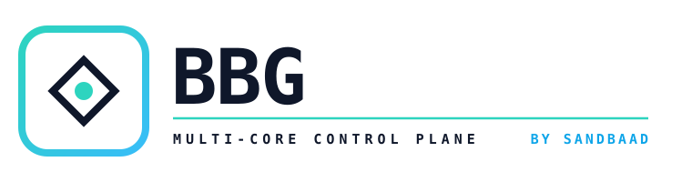

<p align="center">
  <picture>
    <source media="(prefers-color-scheme: dark)" srcset="assets/logo-light.svg">
    
  </picture>
</p>

<p align="center"><a href="README.md">English</a> · <b>فارسی</b></p>

<div dir="rtl">

<p align="center">پنل VPN شخصی خودتان؛ رایگان روی Cloudflare با یک کلیک، یا روی سرور خودتان با Xray و sing-box.</p>

<p align="center">
  <a href="https://deploy.workers.cloudflare.com/?url=https://github.com/SandBaad/BBG"></a>
</p>

---

## کدام نسخه؟

| | کلادفلر | سرور شخصی |
| --- | --- | --- |
| **کجا اجرا می‌شود** | حساب رایگان کلادفلر خودتان | هر سرور لینوکسی، Docker یا Railway |
| **پروتکل‌ها** | VLESS و Trojan روی WebSocket + TLS | REALITY، Shadowsocks 2022، AnyTLS، ShadowTLS، Hysteria2، WS / XHTTP / gRPC و پروکسی تلگرام |
| **هزینه** | رایگان (۱۰۰ هزار درخواست در روز) | هزینهٔ سرورتان |
| **نصب** | یک کلیک | چند دستور |

هر دو نسخه یک پنل دارند: فارسی و انگلیسی، تیره و روشن، مناسب موبایل. هر مشترک یک لینک دارد که در v2rayNG، v2rayN، Hiddify، sing-box، Clash و Karing کار می‌کند، به‌اضافهٔ یک صفحهٔ شخصی با QR و حجم باقی‌مانده.

## نصب روی کلادفلر

1. روی دکمهٔ **Deploy to Cloudflare** در بالا بزنید و وارد کلادفلر شوید. حساب رایگان کافی است.
2. وقتی خواست، گیت‌هاب یا گیت‌لب را وصل کنید. کلادفلر یک کپی از این پروژه در حساب شما می‌سازد و از روی آن نصب می‌کند.
3. دو مقدار را پر کنید:
   - رمز پنل (`ADMIN_PASSWORD`): حداقل ۱۰ حرف.
   - آخر آدرس پنل (`ADMIN_PATH`): مثلاً `my-panel-7k2`؛ فقط حروف انگلیسی، عدد، `-` و `_`.
4. نصب را بزنید و حدود یک دقیقه صبر کنید.
5. پنل را در این آدرس باز کنید و با نام کاربری `admin` وارد شوید (به‌جای YOUR-SUBDOMAIN و ADMIN_PATH مقدارهای خودتان را بگذارید): `https://bbg-panel.YOUR-SUBDOMAIN.workers.dev/ADMIN_PATH`

آدرس دقیق Worker در صفحهٔ آن در داشبورد کلادفلر نوشته شده است. خودِ آدرس، بدون بخش ADMIN_PATH در انتها، عمداً صفحهٔ «404 Not Found» نشان می‌دهد.

اولین مشترک از قبل ساخته شده است: بخش **مشترکین** را باز کنید، لینک را کپی کنید و در برنامهٔ VPN بزنید.

> **نکته برای ایران:** آدرس `workers.dev` معمولاً فیلتر است. یک دامنهٔ شخصی به Worker وصل کنید (در کلادفلر: **Settings → Domains & Routes → Add → Custom domain**) و همان را در پنل، در **تنظیمات ← دامنهٔ شخصی**، بنویسید. چند IP تمیز کلادفلر هم در همان‌جا کمک می‌کند.

**رمز را فراموش کرده‌اید یا آدرس دیگری می‌خواهید؟** در داشبورد کلادفلر، Worker را باز کنید و در **Settings → Variables and Secrets** مقدار `ADMIN_PASSWORD` یا `ADMIN_PATH` را عوض کنید. پنل تا یک دقیقه بعد مقدار جدید را می‌گیرد.

## نصب برای دیگران فقط با یک توکن

پوشهٔ `installer` یک صفحهٔ وب ساده است، با ربات تلگرام اختیاری. هر کسی توکن کلادفلرش را آن‌جا می‌دهد و یک پنل آماده تحویل می‌گیرد: آدرس، رمز و لینک اشتراک اولین کاربر. حساب گیت‌هاب لازم نیست و توکن فقط یک بار استفاده و هیچ‌جا ذخیره نمی‌شود.

برای بالا آوردن نصب‌کننده روی حساب کلادفلر خودتان یکی از این دو راه را بروید:

- **با یک کلیک:** [نصب‌کننده را دیپلوی کنید](https://deploy.workers.cloudflare.com/?url=https://github.com/SandBaad/BBG/tree/main/installer).
- **همیشه به‌روز با GitHub Actions:** در همین مخزن به **Settings → Secrets and variables → Actions** بروید و دو Secret اضافه کنید: `CLOUDFLARE_API_TOKEN` (ساخته‌شده با قالب «Edit Cloudflare Workers») و `CLOUDFLARE_ACCOUNT_ID`. بعد از تب **Actions**، گزینهٔ **Deploy installer** را اجرا کنید. با هر push دوباره دیپلوی می‌شود و آدرسش در صفحهٔ همان اجرا نوشته می‌شود.

آدرس نصب‌کننده: `https://bbg-installer.YOUR-SUBDOMAIN.workers.dev`

<details>
<summary><b>ربات تلگرام (اختیاری)</b></summary>

1. با [@BotFather](https://t.me/BotFather) یک ربات بسازید و توکنش را کپی کنید.
2. دو Secret اضافه کنید: `TELEGRAM_BOT_TOKEN` (توکن ربات) و `TELEGRAM_WEBHOOK_SECRET` (یک رشتهٔ تصادفی بلند از حروف و عدد).
   - اگر از GitHub Actions استفاده می‌کنید، کنار Secretهای کلادفلر بگذاریدشان؛ اجرای بعدی ربات را وصل می‌کند.
   - در غیر این صورت، در داشبورد کلادفلر به Worker با نام `bbg-installer` اضافه‌شان کنید و یک بار این آدرس را باز کنید (به‌جای YOUR-WEBHOOK-SECRET همان رشتهٔ تصادفی را بگذارید): `https://bbg-installer.YOUR-SUBDOMAIN.workers.dev/tg/setup?key=YOUR-WEBHOOK-SECRET`
3. برای نمایش ربات روی صفحهٔ وب، نام کاربری‌اش را در `installer/wrangler.toml` جلوی `TELEGRAM_BOT_USERNAME` بنویسید.

</details>

## نصب روی سرور شخصی

**با Docker**

<div dir="ltr">

```bash
git clone https://github.com/SandBaad/BBG.git && cd BBG
docker build -t bbg .
docker run -d --name bbg --restart unless-stopped \
  -p 8080:8080 -p 8443:8443 -v bbg-data:/data \
  -e BBG_ADMIN_PASSWORD='a-long-password' \
  -e BBG_PUBLIC_DOMAIN='panel.example.com' \
  bbg
```

</div>

- پورت `8080` پنل و مسیرهای CDN است. آن را پشت HTTPS (Caddy، Nginx یا کلادفلر) روی دامنهٔ `BBG_PUBLIC_DOMAIN` بگذارید.
- پورت `8443` برای REALITY، AnyTLS، Shadowsocks و پروکسی تلگرام است و باید مستقیم در دسترس باشد.
- با نام کاربری `admin` و رمز `BBG_ADMIN_PASSWORD` وارد شوید. اگر رمز ندهید، اولین ورود یک کلید یک‌بارمصرف می‌خواهد که در لاگ چاپ شده است (`docker logs bbg`).

**بدون Docker** (Node.js نسخهٔ ۲۰ یا بالاتر)

<div dir="ltr">

```bash
node scripts/install-binaries.mjs      # downloads Xray, sing-box and mtg
BBG_ADMIN_PASSWORD='a-long-password' DATA_DIR=./data npm start
```

</div>

**روی Railway:** پروژهٔ جدید ← Deploy from GitHub repo ← همین مخزن. یک Volume روی ‎`/data`، متغیر `BBG_ADMIN_PASSWORD`، یک دامنهٔ عمومی برای پورت `8080` و یک TCP Proxy برای پورت `8443` اضافه کنید. همهٔ متغیرها: [docs/RAILWAY.md](docs/RAILWAY.md)

## امنیت

- رمزها به‌صورت هش نمک‌دار ذخیره می‌شوند، تعداد تلاش ورود محدود است و نشست‌ها با کوکی امضاشده نگه داشته می‌شوند.
- لینک هر مشترک یک توکن تصادفی بلند است که هر وقت بخواهید عوضش می‌کنید.
- در نسخهٔ کلادفلر صفحهٔ «راه‌اندازی اولیه» وجود ندارد، پس کسی نمی‌تواند زودتر از شما پنل را تصاحب کند. آدرس‌های ناشناخته فقط یک صفحهٔ ۴۰۴ معمولی nginx نشان می‌دهند.
- ربات تلگرام پیام حاوی توکن را بلافاصله پاک می‌کند.

جزئیات کامل: [docs/SECURITY.md](docs/SECURITY.md)

## توسعه

<div dir="ltr">

```bash
npm test                         # Worker and installer tests, no internet needed
node scripts/build-worker.mjs    # run after editing public/ to rebuild the Worker bundles
```

</div>

پوشه‌ها: `src` سرور · `worker` کلادفلر · `installer` نصب‌کننده · `public` رابط کاربری مشترک · `docs` یادداشت‌ها

<p align="center"><sub>© 2026 SANDBAAD</sub></p>

</div>
